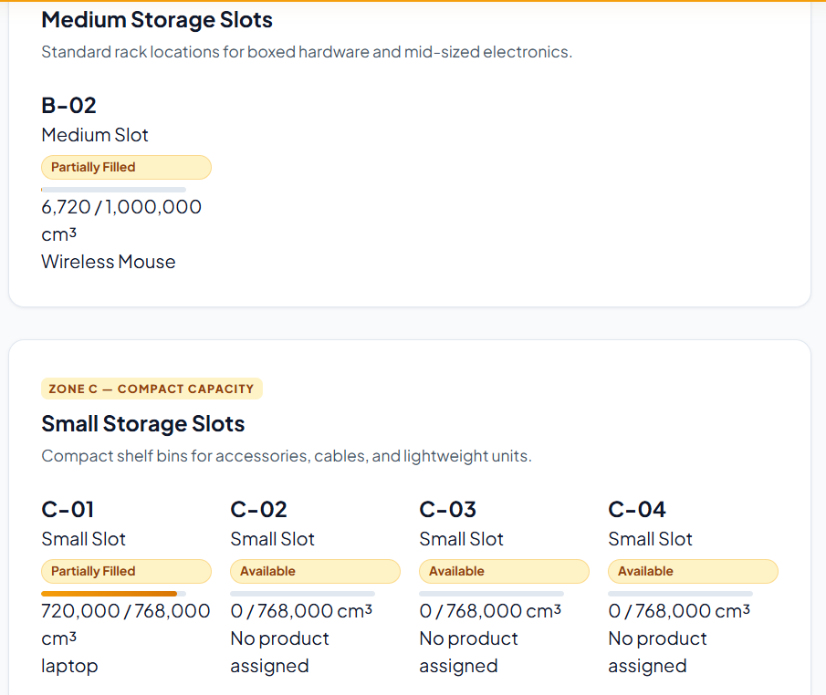
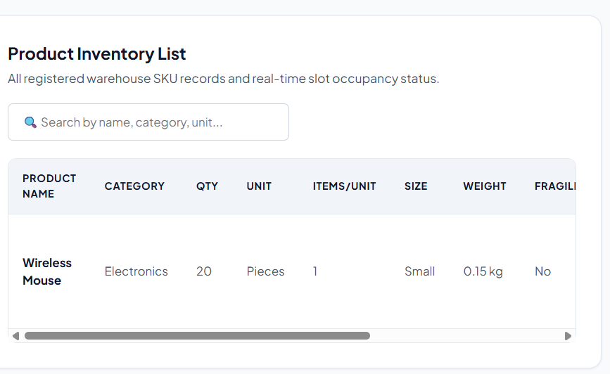
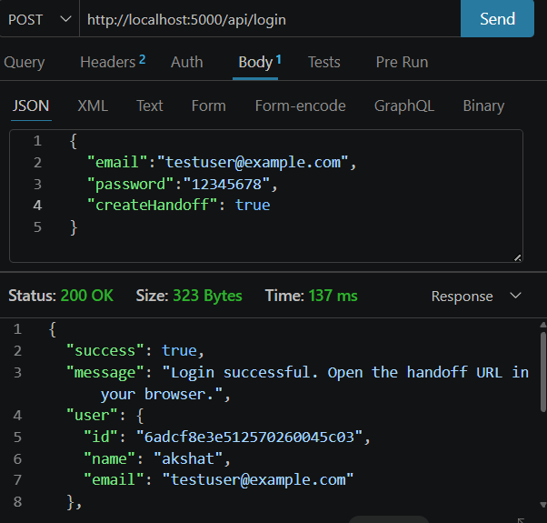

# Storvia – Smart Warehouse Management System

## About the Project
Storvia is a Smart Warehouse Management System that helps manage warehouse products, storage slots, and inventory. I developed the backend using Node.js, Express.js, and MongoDB to store and manage data.

## Features
- Manage products and inventory.
- Add, update, and delete products.
- Create, update, and delete warehouse slots.
- Store data in MongoDB.
- REST APIs for communication between frontend and backend.
- ML-based product demand prediction (planned for integration).

## Technologies Used
- HTML, CSS, JavaScript
- Node.js and Express.js
- MongoDB
- REST API
- Python and Machine Learning

## Screenshots

### 1. Warehouse Dashboard

### 2. Product Management

### 3. API Testing

## How to Run the Backend

1. Clone this repository.
2. Install dependencies:
   `npm install`
3. Create a `.env` file and add your MongoDB connection string:

   `MONGO_URI=mongodb_connection_string`

   `PORT=5000`

4. Start the server:

   `npm start`

## API Endpoints

| Method | Endpoint | Purpose |
|---|---|---|
| GET | `/api/health` | Check server status |
| POST | `/api/signup` | Register a user |
| POST | `/api/login` | Log in a user |
| GET | `/api/products` | Get products |
| POST | `/api/products` | Add a product |
| PUT | `/api/products/:id` | Update a product |
| DELETE | `/api/products/:id` | Delete a product |
| GET | `/api/slots` | Get warehouse slots |
| POST | `/api/slots` | Create slots |
| PUT | `/api/slots/:id` | Update a slot |
| DELETE | `/api/slots/:id` | Delete a slot |

*Note: Product and slot endpoints may require a `userEmail` query parameter.*

